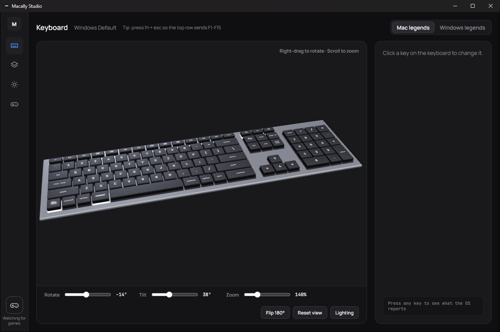
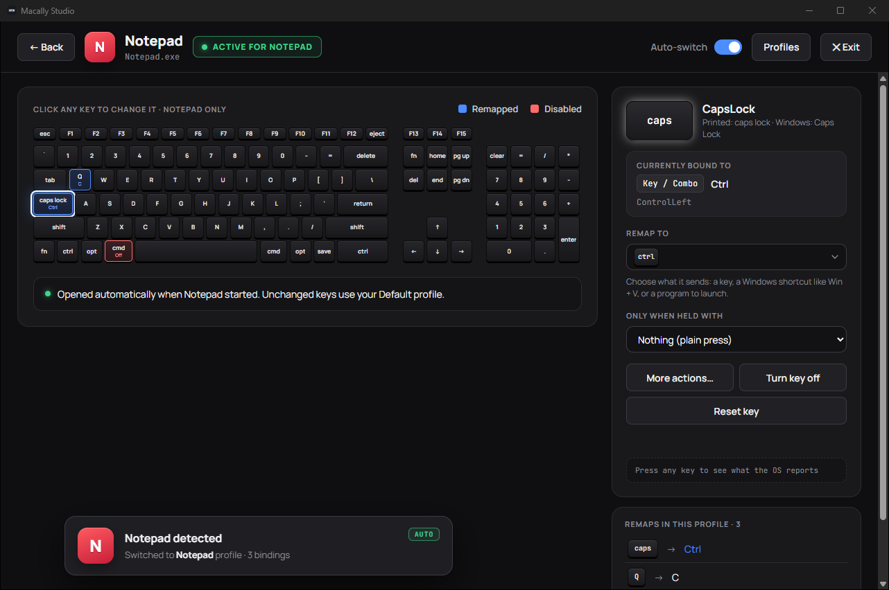
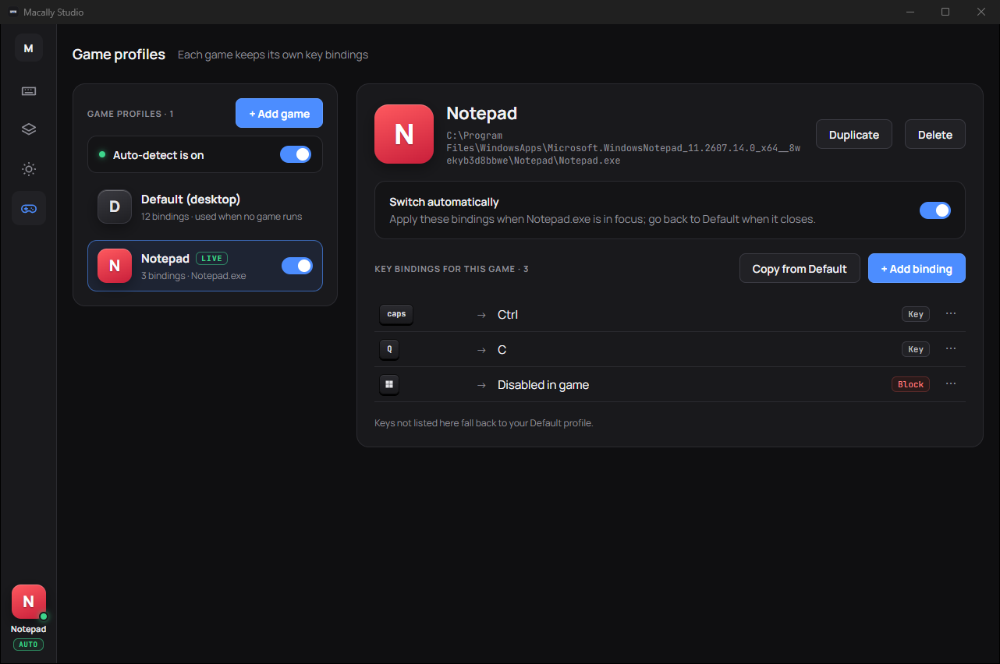
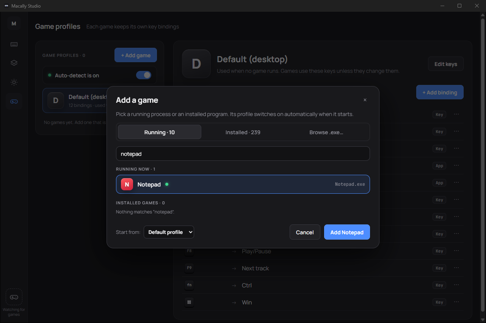
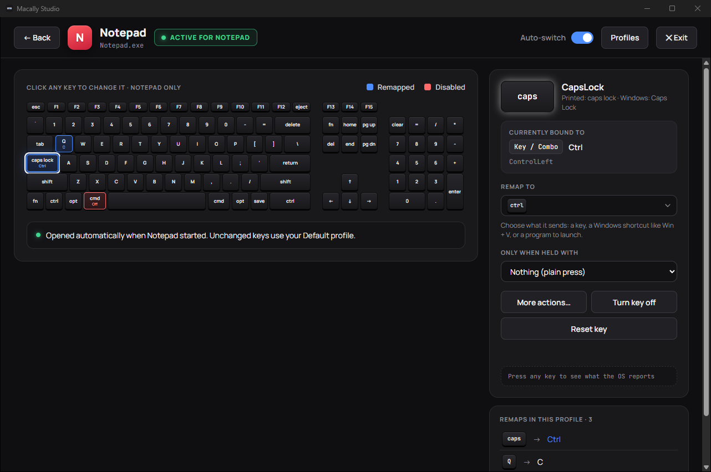
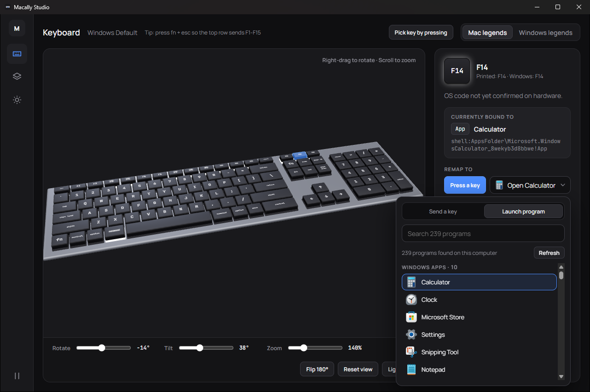
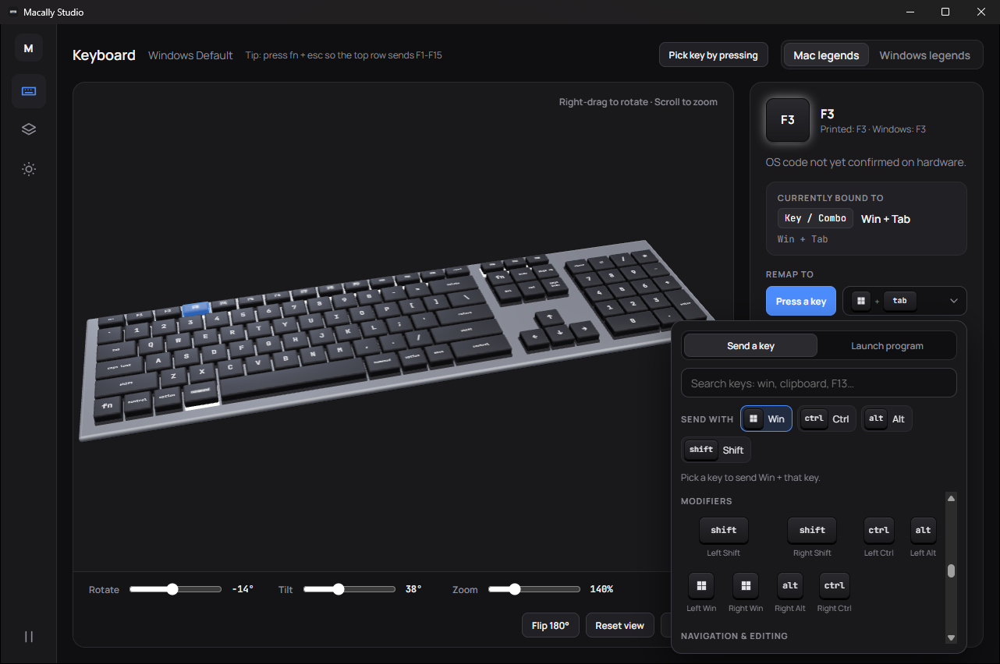
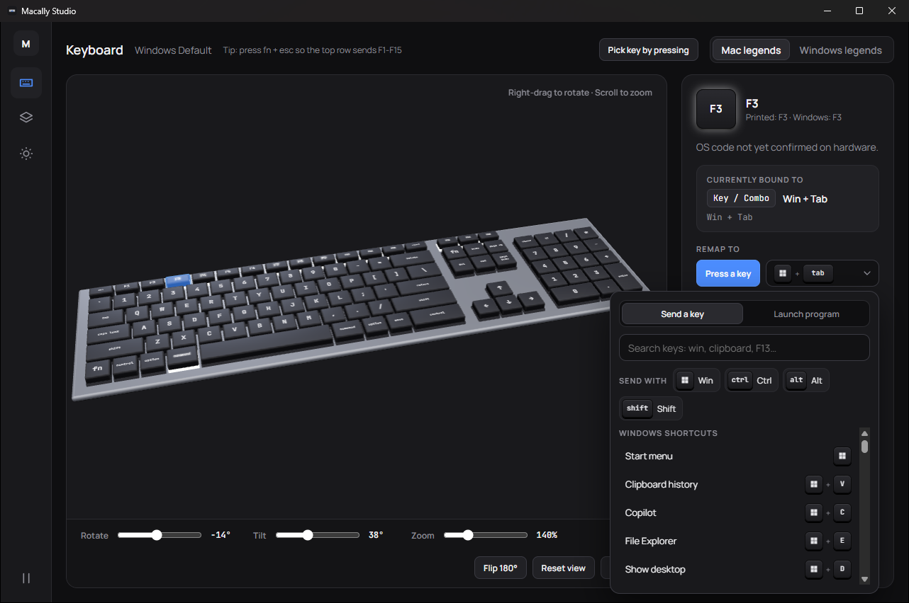

<div align="center">


# Macally Studio

### Every key on your Macally keyboard, your way.

Remap keys, launch apps and Steam games, and switch profiles automatically, on Windows and macOS.

[](https://github.com/TyroneMadison/Macally-Studio/releases/latest)
[](#windows)
[](#macos)
[](LICENSE)

**Works on** &nbsp;  Windows 10 and 11 &nbsp;&nbsp;·&nbsp;&nbsp;  macOS on Intel and Apple Silicon

<a href="https://github.com/TyroneMadison/Macally-Studio/releases/latest"></a>

</div>

---

## Features

<table>
  <tr>
    <td width="33%" valign="top"><b>Remap any key</b><br>Click a key, then pick what it sends from a list of keycaps, Windows key included, with ready-made shortcuts like <kbd>Win</kbd>+<kbd>V</kbd> and <kbd>Win</kbd>+<kbd>C</kbd>, or turn it off. It saves at once. Add "only when held with" modifiers for a second set of bindings. The Key Monitor shows what the system reports for any key.</td>
    <td width="33%" valign="top"><b>Profiles</b><br>Switch by hand, by hotkey (next, previous, or one per profile), or automatically when a chosen app comes to the front.</td>
    <td width="33%" valign="top"><b>Launch any app</b><br>Desktop apps, Microsoft Store apps and system apps such as Calculator, Clock and Settings on Windows; every app on macOS. Searchable, with icons.</td>
  </tr>
  <tr>
    <td valign="top"><b>Steam games</b><br>Your whole Steam library, found automatically. One key, one game.</td>
    <td valign="top"><b>Open and run</b><br>Bind a website, file, folder or command line. Commands can run hidden.</td>
    <td valign="top"><b>3D keyboard</b><br>A to-scale model of the keyboard. Click a key to bind it, spin it a full 360°, tilt it, zoom to 250 %. Bound keys glow; adjustable brightness and backlight; Mac or Windows legends.</td>
  </tr>
  <tr>
    <td valign="top"><b>Game profiles</b><br>Add a game that runs or is installed and it gets its own keys, on top of your Default profile. They switch in while the game is in front and back when you leave it, with a notice and the game in the corner.</td>
    <td valign="top"><b>Tray and menu bar</b><br>Switch profiles and check for updates from the tray. Starts at login and closes to the tray.</td>
    <td valign="top"><b>Updates itself</b><br>Checks GitHub Releases on launch and installs a new version with one click.</td>
  </tr>
</table>

## Screenshots

| Keyboard | Game detected |
| :---: | :---: |
|  |  |
| **Game profiles** | **Add a game** |
|  |  |

<p align="center"><br><sub>The full-screen editor that opens when a game's profile switches in</sub></p>

## Install

Download from the [latest release](https://github.com/TyroneMadison/Macally-Studio/releases/latest). After that, Macally Studio updates itself.

### Windows

1. Download the file ending in `_x64-setup.exe` (the `.msi` works too).
2. Run it. The installer is not code-signed yet, so SmartScreen may say "Windows protected your PC": click **More info**, then **Run anyway**.
3. Press **fn + esc** once on the keyboard (Fn-Lock) so the top row sends F1–F15. Macally Studio opens with the **Windows Default** profile: command is the Windows key (tap it for Start; Win+V, Win+C and the rest work), option is Alt, F3 opens Task View, F4 the Start menu, F7–F12 control media and volume, F13 takes a screenshot, F14 opens Calculator and F15 opens Clock. Edit it as you like; **Profiles → Restore defaults** brings back these bindings.
4. Want remaps inside apps that run as administrator? Turn on **Settings → Run as administrator**.

### macOS

1. Download the file ending in `_universal.dmg` (Intel and Apple Silicon).
2. Open it and drag **Macally Studio** into **Applications**.
3. The app is not notarized yet, so the first launch is blocked. Open **System Settings → Privacy & Security**, scroll down and click **Open Anyway** next to Macally Studio. On macOS 14 and earlier you can instead right-click the app and choose **Open**.
4. If macOS says the app "is damaged", run this in Terminal, then open it again:
   ```sh
   xattr -cr "/Applications/Macally Studio.app"
   ```
5. Allow **Accessibility** and **Input Monitoring** when asked. Until both are on, the app shows a permissions screen with buttons that open each System Settings pane. It closes by itself and remapping starts a few seconds after both are on. The app starts with the **macOS Default** profile, which leaves every key as it is.

## Known limits

- **fn and the backlight keys** (F5 and F6 by default) are handled inside the keyboard itself and never reach the computer, so no app can remap them.
- **Fn-Lock for Windows Default.** Its top-row bindings expect Fn-Lock on: press fn+esc once so the top row sends F1–F15. With Fn-Lock off, F3, F4 and F13–F15 send the keyboard's own macros and the profile seems to do nothing. F7–F12 are bound to media and volume so they keep their printed functions with Fn-Lock on.
- **Admin windows on Windows.** Windows does not let a normal app send keys to an app running as administrator. Turn on **Run as administrator** in Settings if you need that.
- **Some games** read the keyboard directly (raw input) and see the physical key, not the remapped one.
- **All keyboards.** Bindings apply to every connected keyboard for now.
- **Games behind a launcher.** A game profile watches the exe you add (a Steam game: anything in its install folder). If the program you picked is only a launcher, start the game and add it from Running instead. Microsoft Store (UWP) apps are not detected.
- **Caps Lock on macOS.** macOS reports Caps Lock once per press, not as a press and a release, so a Caps Lock binding sends a quick tap even while you hold the key, and Caps Lock itself still turns on and off.
- **Password fields on macOS.** While a secure text field has focus, macOS hides key presses from all apps, so remaps pause there.
- **After an update on macOS**, open System Settings → Privacy & Security, remove Macally Studio from Accessibility and Input Monitoring with the minus button, and add it again (the app is not signed yet, so macOS treats each version as a new app).

## Build from source

You need [Node.js](https://nodejs.org) 22.12 or newer, [Rust](https://rustup.rs) 1.90 or newer, and the build tools for your system: Microsoft C++ Build Tools ("Desktop development with C++") on Windows, Xcode Command Line Tools (`xcode-select --install`) on macOS.

```sh
git clone https://github.com/TyroneMadison/Macally-Studio.git
cd Macally-Studio
npm install
npm run tauri dev
```

Run the tests:

```sh
npm test
npm run build
cargo test --manifest-path src-tauri/Cargo.toml
```

Installers come from GitHub Actions, which holds the update signing key. To compile a local release build without installers, run `npm run tauri build -- --no-bundle`; the app lands in `src-tauri/target/release/`.

## 📜 Changelog

[](https://github.com/TyroneMadison/Macally-Studio/releases/latest) [](CHANGELOG.md) [](https://github.com/TyroneMadison/Macally-Studio/commits/main)

Legend: ✨ new · 🐛 fix · 🔥 removed · 🎨 look and feel · 📝 docs · 🔖 version bump

### 🎮 v1.4 · Gaming profiles

[](https://github.com/TyroneMadison/Macally-Studio/releases/tag/v1.4) 

Every game gets its own keys, which switch in while the game is in front and back when you leave it. The 3D keyboard no longer jitters while it turns, a key is remapped by clicking, and play/pause is gone (remapping is always on).

- ✨ Game profiles in the store: each game gets its own profile, with the game's exe or install folder, icon and auto-switch flag [`3cf8937`](https://github.com/TyroneMadison/Macally-Studio/commit/3cf8937)
- ✨ Tell which game an app starts: the exe of a program, shortcut or Start-menu app, or a Steam game's install folder; share the icon cache [`31e70be`](https://github.com/TyroneMadison/Macally-Studio/commit/31e70be)
- ✨ Switch to a game's profile while the game is in front and back when it loses focus or quits, debounced; commands and a profile-switched event for the coming games UI [`c0dc232`](https://github.com/TyroneMadison/Macally-Studio/commit/c0dc232)
- 🐛 Fix the 3D keyboard jittering while it is rotated: the camera's own moves no longer come back to it as requests [`1c7e2ec`](https://github.com/TyroneMadison/Macally-Studio/commit/1c7e2ec)
- 🔥 Remap by clicking only: remove Press a key, Pick key by pressing and the engine's Record mode [`21c4d5a`](https://github.com/TyroneMadison/Macally-Studio/commit/21c4d5a)
- 🔥 Remove play/pause and the pause function everywhere: remapping is always on [`c0b5fdf`](https://github.com/TyroneMadison/Macally-Studio/commit/c0b5fdf)
- ✨ Game profiles run on top of the Default profile, a key can be turned off, and a game knows its exe path [`8d37aae`](https://github.com/TyroneMadison/Macally-Studio/commit/8d37aae)
- ✨ Game profiles UI: the game status in the rail corner, the detection notice, the Games panel and Add a game, after the mockups in docs/mockups [`7d8a24e`](https://github.com/TyroneMadison/Macally-Studio/commit/7d8a24e)
- ✨ Full-screen profile editor: opens when a game's profile switches in, detected or picked by hand (04c) [`88489ba`](https://github.com/TyroneMadison/Macally-Studio/commit/88489ba)
- 🎨 Editor and Game profiles polish: short Mac legends (cmd, opt, ctrl, pg up) on the flat keyboard, and a long exe path wraps beside the game instead of pushing Duplicate and Delete down [`d8e0bbb`](https://github.com/TyroneMadison/Macally-Studio/commit/d8e0bbb)
- 📝 README, changelog and real screenshots [`eded7f7`](https://github.com/TyroneMadison/Macally-Studio/commit/eded7f7) [`4dcf5b4`](https://github.com/TyroneMadison/Macally-Studio/commit/4dcf5b4) [`278bc48`](https://github.com/TyroneMadison/Macally-Studio/commit/278bc48)
- 🔖 Version 1.4 · [compare v1.3…v1.4](https://github.com/TyroneMadison/Macally-Studio/compare/v1.3...v1.4)

<table><tr>
<td></td>
<td></td>
</tr></table>

### 🚀 v1.3 · Launch program

[](https://github.com/TyroneMadison/Macally-Studio/releases/tag/v1.3) 

- ✨ Launch program in the key picker: installed programs from Start-menu shortcuts, App Paths and the Uninstall registry, with icons and search; programs start in their own folder [`0050236`](https://github.com/TyroneMadison/Macally-Studio/commit/0050236)
- 🔖 Version 1.3 [`e9d14b6`](https://github.com/TyroneMadison/Macally-Studio/commit/e9d14b6) · [compare v1.2…v1.3](https://github.com/TyroneMadison/Macally-Studio/compare/v1.2...v1.3)

<p align="center"></p>

### 🪟 v1.2 · The Windows key and the keycap picker

[](https://github.com/TyroneMadison/Macally-Studio/releases/tag/v1.2) 

- 🐛 Fix the dead Windows key: Command is Win again, keys remapped to Win work in any chord, and swallowed presses no longer pop Start [`aa7d35c`](https://github.com/TyroneMadison/Macally-Studio/commit/aa7d35c)
- ✨ Keycap picker: every key as a thumbnail, Windows logo on Win, send-with modifiers and Windows shortcuts like Win+V [`38ce4dd`](https://github.com/TyroneMadison/Macally-Studio/commit/38ce4dd)
- 🔖 Version 1.2 [`9aa366a`](https://github.com/TyroneMadison/Macally-Studio/commit/9aa366a) · [compare v1.1…v1.2](https://github.com/TyroneMadison/Macally-Studio/compare/v1.1...v1.2)

<table><tr>
<td></td>
<td></td>
</tr></table>

### 🌀 v1.1 · 360° view, lighting and easy remapping

[](https://github.com/TyroneMadison/Macally-Studio/releases/tag/v1.1) 

- ✨ 3D view: full 360 orbit with tilt, brighter studio lighting, adjustable brightness and backlight [`85c1644`](https://github.com/TyroneMadison/Macally-Studio/commit/85c1644)
- ✨ Remap keys by pressing or choosing from a list, pick keys by pressing them, and edit built-in profiles in place [`a3fa956`](https://github.com/TyroneMadison/Macally-Studio/commit/a3fa956)
- 🐛 Remap fixes: one recording at a time, edits end a recording, saves build on the latest binding, hide keys the OS cannot send, zoom to 250% [`2b0eab2`](https://github.com/TyroneMadison/Macally-Studio/commit/2b0eab2)
- 🎨 Start the 3D view closer and refresh the keyboard screenshot [`c6e1853`](https://github.com/TyroneMadison/Macally-Studio/commit/c6e1853)
- 🔖 Version 1.1 [`bcba892`](https://github.com/TyroneMadison/Macally-Studio/commit/bcba892) · [compare v1.0…v1.1](https://github.com/TyroneMadison/Macally-Studio/compare/v1.0...v1.1)

<p align="center"></p>

### 🎉 v1.0 · First release, and everything before it

[](https://github.com/TyroneMadison/Macally-Studio/releases/tag/v1.0)  

The whole app came together in the commits up to the `v1.0` tag, from the first scaffold to the first public installers.

<details>
<summary><b>All 57 commits up to v1.0</b>, grouped by area</summary>

**🧱 Foundation**

- Scaffold Tauri app shell, theme, fonts, version policy, release script and CI [`f4078f0`](https://github.com/TyroneMadison/Macally-Studio/commit/f4078f0)
- Add 107-key layout, keymap, get_layout command and the 3D keyboard view [`1668c19`](https://github.com/TyroneMadison/Macally-Studio/commit/1668c19)
- Add Blender keyboard generator and README hero render [`499f266`](https://github.com/TyroneMadison/Macally-Studio/commit/499f266)
- Tidy gitignore [`94afd87`](https://github.com/TyroneMadison/Macally-Studio/commit/94afd87)

**⌨️ Remap engine**

- Add action types [`c7185b7`](https://github.com/TyroneMadison/Macally-Studio/commit/c7185b7)
- Add the remap engine core [`6d865df`](https://github.com/TyroneMadison/Macally-Studio/commit/6d865df)
- Add the Windows keyboard hook and hook self-test [`233a8a3`](https://github.com/TyroneMadison/Macally-Studio/commit/233a8a3)
- Add the macOS event tap [`db051d2`](https://github.com/TyroneMadison/Macally-Studio/commit/db051d2)
- Run key actions and start the engine [`7a51b42`](https://github.com/TyroneMadison/Macally-Studio/commit/7a51b42)
- Keep held-with modifiers out of injected chords on Windows [`6810624`](https://github.com/TyroneMadison/Macally-Studio/commit/6810624)
- Give macOS key events the flags of remapped modifiers so Cmd remapped to Ctrl makes Cmd+C arrive as Ctrl+C [`2e1b09d`](https://github.com/TyroneMadison/Macally-Studio/commit/2e1b09d)
- Treat each macOS Caps Lock event as a full key press [`ba2ba6a`](https://github.com/TyroneMadison/Macally-Studio/commit/ba2ba6a)

**🗂️ Profiles and settings**

- Add profile and settings store [`6aecf74`](https://github.com/TyroneMadison/Macally-Studio/commit/6aecf74)
- Ship Windows Default and macOS Default profiles [`da35ef2`](https://github.com/TyroneMadison/Macally-Studio/commit/da35ef2)
- Add profile and settings commands [`854c8a5`](https://github.com/TyroneMadison/Macally-Studio/commit/854c8a5)
- Add typed IPC wrappers and app state [`e3b48a2`](https://github.com/TyroneMadison/Macally-Studio/commit/e3b48a2)
- Add hotkey formatting and profile helpers [`3af215d`](https://github.com/TyroneMadison/Macally-Studio/commit/3af215d)
- Add Profiles view [`016c76b`](https://github.com/TyroneMadison/Macally-Studio/commit/016c76b)
- Add Settings view [`cdc5177`](https://github.com/TyroneMadison/Macally-Studio/commit/cdc5177)
- Note that every profile switch goes through AppState::activate [`3406f53`](https://github.com/TyroneMadison/Macally-Studio/commit/3406f53)
- Drop clashing hotkeys on import and back up unreadable settings.json [`4608508`](https://github.com/TyroneMadison/Macally-Studio/commit/4608508)
- Queue saves and send only the changed fields so quick edits do not undo each other [`b9c2054`](https://github.com/TyroneMadison/Macally-Studio/commit/b9c2054)
- Show the Fn-Lock hint, keyboard key count and permissions note [`9c920ec`](https://github.com/TyroneMadison/Macally-Studio/commit/9c920ec)
- Add the foreground watcher and per-app profile switching [`41e8629`](https://github.com/TyroneMadison/Macally-Studio/commit/41e8629)
- Add global hotkeys [`cbcf57b`](https://github.com/TyroneMadison/Macally-Studio/commit/cbcf57b)
- Check the community example profile in a Rust test [`84381c6`](https://github.com/TyroneMadison/Macally-Studio/commit/84381c6)

**🖥️ App, tray and permissions**

- Add the tray menu [`fc45809`](https://github.com/TyroneMadison/Macally-Studio/commit/fc45809)
- Wire the engine, tray, hotkeys, foreground watcher and macOS permissions screen into the app [`860a358`](https://github.com/TyroneMadison/Macally-Studio/commit/860a358)
- Ask for elevation once per run and apply login settings only at startup and when they change [`a4986f8`](https://github.com/TyroneMadison/Macally-Studio/commit/a4986f8)
- Run get_status off the main thread [`d93e539`](https://github.com/TyroneMadison/Macally-Studio/commit/d93e539)
- Start the window hidden so a login start never flashes it, and reopen it from the Dock on macOS [`5a125cd`](https://github.com/TyroneMadison/Macally-Studio/commit/5a125cd)

**🧭 App catalog and action picker**

- Add app catalog entry type, icon file names, ordering and dedupe [`bcee5a6`](https://github.com/TyroneMadison/Macally-Studio/commit/bcee5a6)
- Add Steam library scanner with libraryfolders and appmanifest parsing [`80ba73d`](https://github.com/TyroneMadison/Macally-Studio/commit/80ba73d)
- Add Windows Start apps scanner with shell icon extraction [`e5df627`](https://github.com/TyroneMadison/Macally-Studio/commit/e5df627)
- Add macOS app bundle scanner with NSWorkspace icons [`e6679ec`](https://github.com/TyroneMadison/Macally-Studio/commit/e6679ec)
- Cache the app catalog and add get_catalog and refresh_catalog commands [`2bcb149`](https://github.com/TyroneMadison/Macally-Studio/commit/2bcb149)
- Add chord, record and catalog helpers for the action picker [`cb926a5`](https://github.com/TyroneMadison/Macally-Studio/commit/cb926a5)
- Add chord field with Record for key combo bindings [`ae1cad9`](https://github.com/TyroneMadison/Macally-Studio/commit/ae1cad9)
- Add action picker with app, Steam, URL, command and profile tabs [`204a421`](https://github.com/TyroneMadison/Macally-Studio/commit/204a421)
- Add key inspector and key monitor strip [`fc21da7`](https://github.com/TyroneMadison/Macally-Studio/commit/fc21da7)
- Wire the inspector, action picker and key monitor into the Keyboard view [`33d6ab5`](https://github.com/TyroneMadison/Macally-Studio/commit/33d6ab5)
- Keep Monitor mode after a Record ends in an unmounted chord field [`93bb87d`](https://github.com/TyroneMadison/Macally-Studio/commit/93bb87d)
- Keep Key Monitor off while the window is hidden [`545e00c`](https://github.com/TyroneMadison/Macally-Studio/commit/545e00c)
- Keep browsed programs in the catalog and send the last catalog progress after the cache is saved [`f5bbfb5`](https://github.com/TyroneMadison/Macally-Studio/commit/f5bbfb5)
- Always scan the main Steam library [`6f1de1e`](https://github.com/TyroneMadison/Macally-Studio/commit/6f1de1e)
- Show modifiers in OS order and names and reject chords with unknown keys [`45a7ef7`](https://github.com/TyroneMadison/Macally-Studio/commit/45a7ef7)
- Use as_chunks_mut for the icon pixel swap [`d3127c6`](https://github.com/TyroneMadison/Macally-Studio/commit/d3127c6)

**🔄 Updates and releases**

- Set the updater public key [`e8aac19`](https://github.com/TyroneMadison/Macally-Studio/commit/e8aac19)
- Add release workflow, README, contributing guide, community profiles and issue forms [`24466fd`](https://github.com/TyroneMadison/Macally-Studio/commit/24466fd)
- Add update check and install commands [`dfc0f24`](https://github.com/TyroneMadison/Macally-Studio/commit/dfc0f24)
- Open Settings when an update is found [`74e0681`](https://github.com/TyroneMadison/Macally-Studio/commit/74e0681)
- Check for updates from the UI once it listens and fail install when no update exists [`08fe4df`](https://github.com/TyroneMadison/Macally-Studio/commit/08fe4df)

**🎨 Look and docs**

- Render bound keys as backlit caps with glowing legends [`4e32705`](https://github.com/TyroneMadison/Macally-Studio/commit/4e32705)
- Readable key names in the bindings grid and README screenshots [`fc777a3`](https://github.com/TyroneMadison/Macally-Studio/commit/fc777a3)
- Describe the macOS permissions screen in the README [`7d1d945`](https://github.com/TyroneMadison/Macally-Studio/commit/7d1d945)
- Explain re-granting macOS permissions after an update [`e77a13c`](https://github.com/TyroneMadison/Macally-Studio/commit/e77a13c)
- README: mention Fn-Lock in the Windows install steps [`3962f45`](https://github.com/TyroneMadison/Macally-Studio/commit/3962f45)

</details>

<table><tr>
<td></td>
<td></td>
</tr></table>

<sub>Profiles and Settings as they look in Version 1.3.</sub>

## Contributing

Bug reports, ideas, shared profiles and pull requests are welcome. Start with [CONTRIBUTING.md](CONTRIBUTING.md); profiles go in [community/](community/README.md).

## License

[MIT](LICENSE) © 2026 Tyrone Madison

<sub>Macally is a trademark of its owner. Macally Studio is an independent project and is not affiliated with or endorsed by Macally. Apple logo from <a href="https://simpleicons.org">Simple Icons</a> (CC0 1.0).</sub>
