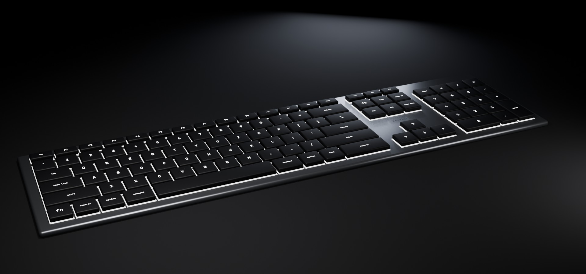
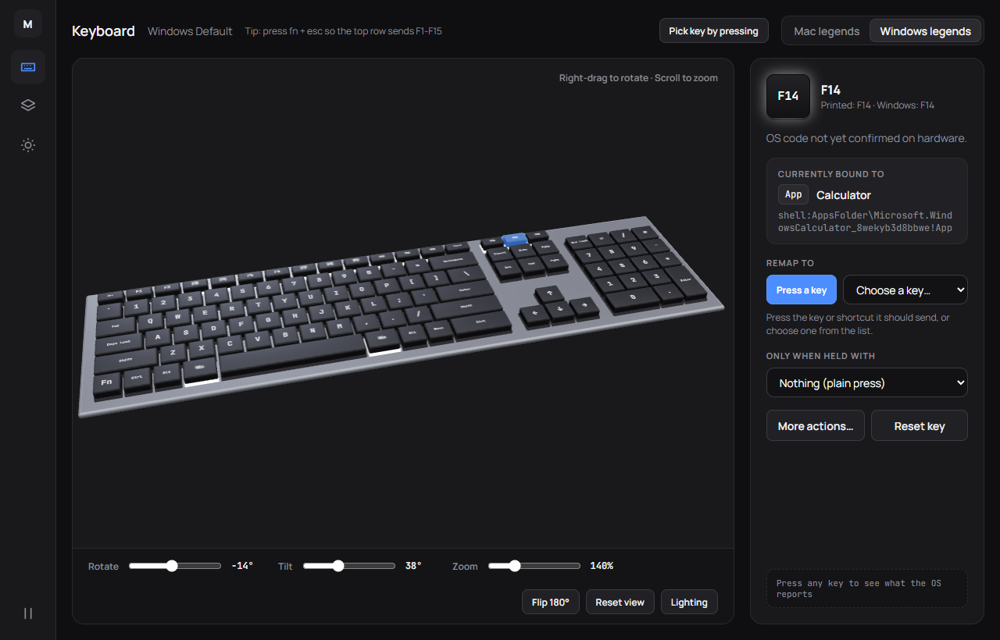
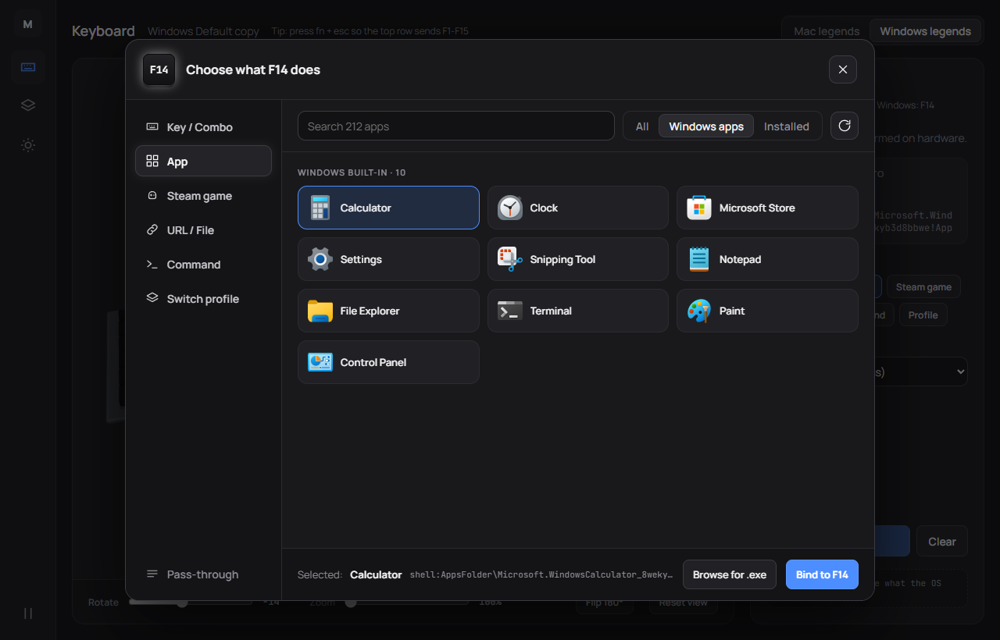
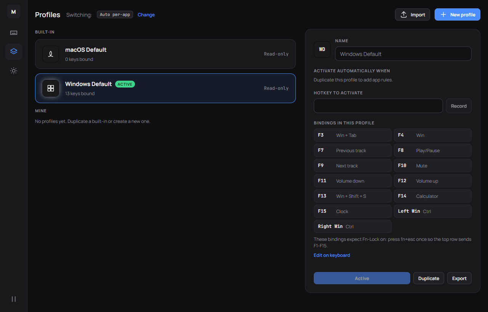
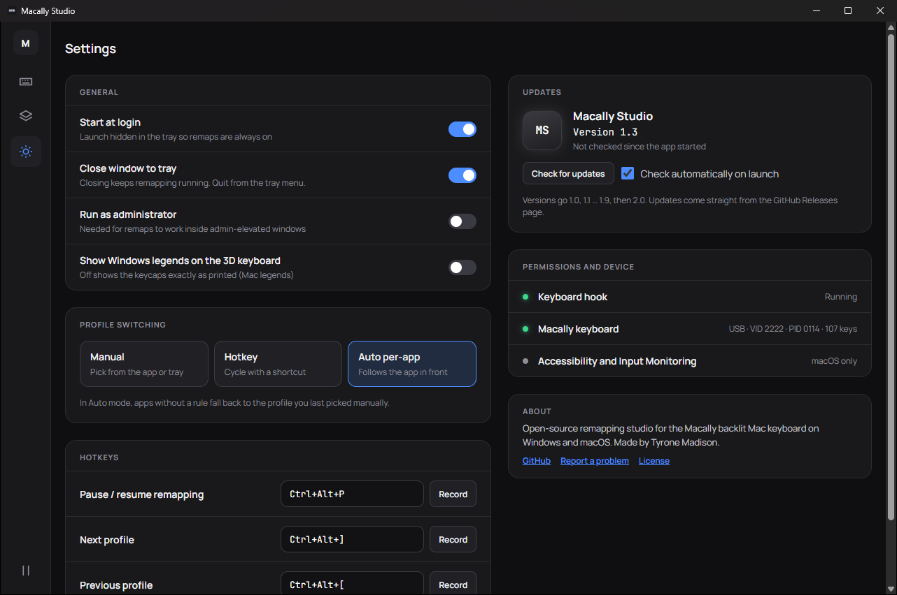

<div align="center">



# Macally Studio

### Every key on your Macally keyboard, your way.

Remap keys, launch apps and Steam games, and switch profiles automatically, on Windows and macOS.

[](https://github.com/TyroneMadison/Macally-Studio/releases/latest)
[](#windows)
[](#macos)
[](LICENSE)

**Works on** &nbsp;  Windows 10 and 11 &nbsp;&nbsp;·&nbsp;&nbsp;  macOS on Intel and Apple Silicon

<a href="https://github.com/TyroneMadison/Macally-Studio/releases/latest"></a>

</div>

---

## Features

<table>
  <tr>
    <td width="33%" valign="top"><b>Remap any key</b><br>Turn any key the computer can see into another key or a chord such as <kbd>Ctrl</kbd>+<kbd>Z</kbd>. Add "only when held with" modifiers for a second set of bindings.</td>
    <td width="33%" valign="top"><b>Profiles</b><br>Switch by hand, by hotkey (next, previous, or one per profile), or automatically when a chosen app comes to the front.</td>
    <td width="33%" valign="top"><b>Launch any app</b><br>Desktop apps, Microsoft Store apps and system apps such as Calculator, Clock and Settings on Windows; every app on macOS. Searchable, with icons.</td>
  </tr>
  <tr>
    <td valign="top"><b>Steam games</b><br>Your whole Steam library, found automatically. One key, one game.</td>
    <td valign="top"><b>Open and run</b><br>Bind a website, file, folder or command line. Commands can run hidden.</td>
    <td valign="top"><b>3D keyboard</b><br>A to-scale model of the keyboard. Click a key to bind it, spin it a full 360°, tilt it, zoom to 150 %. Bound keys glow; adjustable brightness and backlight; Mac or Windows legends.</td>
  </tr>
  <tr>
    <td valign="top"><b>Key Monitor and Record</b><br>See exactly what the system reports for any key, and capture a chord by pressing it.</td>
    <td valign="top"><b>Tray and menu bar</b><br>Switch profiles, pause remapping and check for updates from the tray. Starts at login and closes to the tray.</td>
    <td valign="top"><b>Updates itself</b><br>Checks GitHub Releases on launch and installs a new version with one click.</td>
  </tr>
</table>

## Screenshots

| Keyboard | Action picker |
| :---: | :---: |
|  |  |
| **Profiles** | **Settings** |
|  |  |

## Install

Download from the [latest release](https://github.com/TyroneMadison/Macally-Studio/releases/latest). After that, Macally Studio updates itself.

### Windows

1. Download the file ending in `_x64-setup.exe` (the `.msi` works too).
2. Run it. The installer is not code-signed yet, so SmartScreen may say "Windows protected your PC": click **More info**, then **Run anyway**.
3. Press **fn + esc** once on the keyboard (Fn-Lock) so the top row sends F1–F15. Macally Studio opens with the **Windows Default** profile: command works as Ctrl, option as Alt, F3 opens Task View, F4 the Start menu, F7–F12 control media and volume, F13 takes a screenshot, F14 opens Calculator and F15 opens Clock.
4. Want remaps inside apps that run as administrator? Turn on **Settings → Run as administrator**.

### macOS

1. Download the file ending in `_universal.dmg` (Intel and Apple Silicon).
2. Open it and drag **Macally Studio** into **Applications**.
3. The app is not notarized yet, so the first launch is blocked. Open **System Settings → Privacy & Security**, scroll down and click **Open Anyway** next to Macally Studio. On macOS 14 and earlier you can instead right-click the app and choose **Open**.
4. If macOS says the app "is damaged", run this in Terminal, then open it again:
   ```sh
   xattr -cr "/Applications/Macally Studio.app"
   ```
5. Allow **Accessibility** and **Input Monitoring** when asked. Until both are on, the app shows a permissions screen with buttons that open each System Settings pane. It closes by itself and remapping starts a few seconds after both are on. The app starts with the **macOS Default** profile, which leaves every key as it is.

## Known limits

- **fn and the backlight keys** (F5 and F6 by default) are handled inside the keyboard itself and never reach the computer, so no app can remap them.
- **Fn-Lock for Windows Default.** Its top-row bindings expect Fn-Lock on: press fn+esc once so the top row sends F1–F15. With Fn-Lock off, F3, F4 and F13–F15 send the keyboard's own macros and the profile seems to do nothing. F7–F12 are bound to media and volume so they keep their printed functions with Fn-Lock on.
- **Admin windows on Windows.** Windows does not let a normal app send keys to an app running as administrator. Turn on **Run as administrator** in Settings if you need that.
- **Some games** read the keyboard directly (raw input) and see the physical key, not the remapped one.
- **All keyboards.** Bindings apply to every connected keyboard for now.
- **Caps Lock on macOS.** macOS reports Caps Lock once per press, not as a press and a release, so a Caps Lock binding sends a quick tap even while you hold the key, and Caps Lock itself still turns on and off.
- **Password fields on macOS.** While a secure text field has focus, macOS hides key presses from all apps, so remaps pause there.
- **After an update on macOS**, open System Settings → Privacy & Security, remove Macally Studio from Accessibility and Input Monitoring with the minus button, and add it again (the app is not signed yet, so macOS treats each version as a new app).

## Build from source

You need [Node.js](https://nodejs.org) 22.12 or newer, [Rust](https://rustup.rs) 1.90 or newer, and the build tools for your system: Microsoft C++ Build Tools ("Desktop development with C++") on Windows, Xcode Command Line Tools (`xcode-select --install`) on macOS.

```sh
git clone https://github.com/TyroneMadison/Macally-Studio.git
cd Macally-Studio
npm install
npm run tauri dev
```

Run the tests:

```sh
npm test
npm run build
cargo test --manifest-path src-tauri/Cargo.toml
```

Installers come from GitHub Actions, which holds the update signing key. To compile a local release build without installers, run `npm run tauri build -- --no-bundle`; the app lands in `src-tauri/target/release/`.

## Contributing

Bug reports, ideas, shared profiles and pull requests are welcome. Start with [CONTRIBUTING.md](CONTRIBUTING.md); profiles go in [community/](community/README.md).

## License

[MIT](LICENSE) © 2026 Tyrone Madison

<sub>Macally is a trademark of its owner. Macally Studio is an independent project and is not affiliated with or endorsed by Macally. Apple logo from <a href="https://simpleicons.org">Simple Icons</a> (CC0 1.0).</sub>
